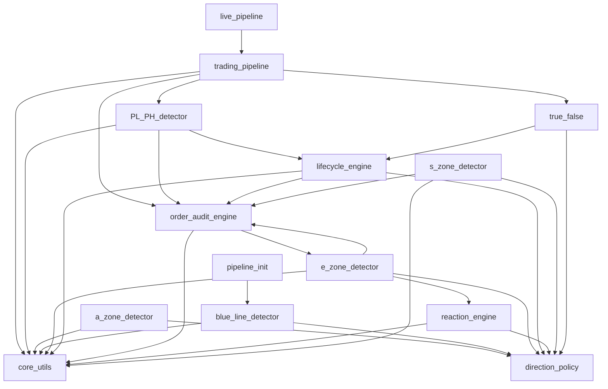

# Dependency graph — current main

Static import edges (including imports inside guarded branches):

The apparent E Zone / OrderAudit cycle is a **syntactic dependency**, not a demonstrated runtime import cycle: OrderAudit's reference to EZone is guarded by TYPE_CHECKING at lines 17–18; E imports OrderAudit at module initialization. Treat type-only edges separately from runtime dependencies. Core Utilities and Direction Policy are shared primitives. Primary imports Lifecycle and OrderAudit. T/F imports Lifecycle and Direction Policy.

## Dynamic closure

Trading Bridge `load_module` (87–94) uses path-based loading and registration; `load_engine` (97–98) selects Reaction; `load_engines` (1892–1927) binds Reaction, Blue, A, S, optional E, Lifecycle with a default path, and optional Primary. These path-driven edges are not ordinary import statements. Native `main` (3717–3748) uses this bundle and shared market/state/response functions. Live Pipeline imports the shared bridge, constructs a continuation and invokes `calculate_live_from_buckets`; the latter replays stages through `_run_live_calculation` (3706–3714). Static import edges must not be mistaken for pipeline execution order. The 23 external import roots listed in the summary are Python standard-library references (including future imports); dynamic engine configuration and environment dependencies still require the runtime contract. Project startup documents require Python 3.12+; analysis here is Python 3.13.5. Chart/Vite/FARAZ are outside the 16-file production Python extraction scope and remain boundary dependencies (Phase 01 Repository_Discovery). No full downstream JavaScript call graph claimed.
