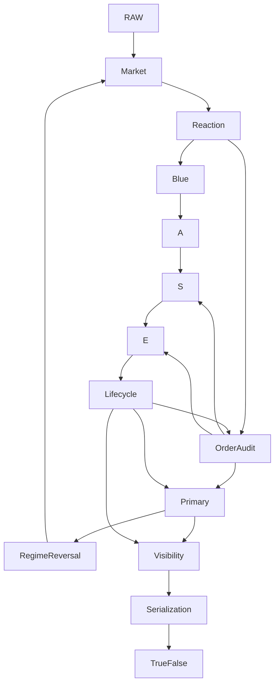

# Architecture and dependencies

The engine is an event-driven system with a shared physical Order ledger and feedback; it is not a one-pass indicator chain.

Reaction owns geometry, Blue owns strike/reset levels, A owns pair/trigger/source, S owns post-A race, OrderAudit owns physical identity and provenance, E owns recursive candidates and reconciliation, Lifecycle owns dominance and StopAll, Primary owns structure/MBL and reversal, Bridge owns orchestration and projection, T/F only annotates final results. Direction policy owns only comparison semantics. Diagram is a conceptual dependency graph, not exact call order.

Supplementary material below is the English semantic prose of the existing synchronized references, pinned to 466eb875070f02cd0dbfb105033422bbe2fd8c70. It is not a fresh branch-level proof. Exact production-source appendices are excluded. Historical acceptance examples remain historical.

## 2. Authoritative pipeline and ownership

The production execution contract is:

`Complete supplied input normalization → both directional Reaction/Reset contexts → cross-direction Internal Reaction classification → Blue → A → initial S → provisional E → S validity/rebuild and accepted A/Order context → final E/OrderAudit → shared physical Order stop reconciliation → consumed-S native continuation → accepted Order_B feedback → lifecycle/StopAll → visibility/lineage closure → final OrderAudit synchronization → serialization`

Order_B feedback may repeat S/E context construction up to eight passes, using exact reset-leg identities. The optional StopAll acceptance gate is identical in feedback and final visibility, and is enabled only when `--lifecycle-engine` is supplied. A repeated non-convergent identity or pass overflow is an error. This feedback does not recalculate Reaction/Blue/A geometry. StopAll is reconciled once from accepted chronology, including previously omitted independent S-root E identities at new physical source candles; downstream boundary publication does not reinterpret historical E.

The bridge calculates the complete input it actually receives. The full-chart HTTP route supplies the original RAW file. A selected-range HTTP route supplies an in-memory stream filtered by inclusive chart-candle buckets; that calculation begins with empty state at the selected start and cannot use rows outside the supplied stream. Within that supplied input, CLI from/to bounds filter presentation after calculation. Neither frontend nor serialization independently implements trading rules.

Ownership boundaries are strict: Reaction/Reset is owned by `reaction_engine.py`; Blue by `blue_line_detector.py`; A by `a_zone_detector.py`; S by `s_zone_detector.py`; E by `e_zone_detector.py`; physical Order discovery/reuse/provenance by `order_audit_engine.py`; lifecycle/StopAll/visibility by `lifecycle_engine.py`; primary PH/PL/MBL state and reversal selection by `PL_PH_detector.py`; request/range and fresh-regime orchestration and serialization by `bridge/trading_pipeline.py`. Serialization is a projection of finalized state and is not a second trading algorithm.

### 13.8 Reconstruction-quality stage contract

This table makes the stage chain reconstructable without relying on examples. The detailed prose in Sections 4–12 remains normative; this table is a compact cross-stage contract and must agree with it.

| Stage | Authoritative inputs / prior state | Opening trigger / gate | Source or selection rule | Chronology / tie rule | Stop / terminal rule | Downstream ownership |
|---|---|---|---|---|---|---|
| Reaction / Reset | normalized main candles, selected lower-TF chronology, directional state | required First role after opposite context; strict confirmation | directional box geometry; opposite edge may evolve only through chronology available by confirmation | lower-TF order resolves confirmation vs invalidation/reset; equal eligible opposite extremes retain earliest owner | confirmed Reaction resets only on first strict directional break of confirmed opposite edge | publishes canonical Reaction/Reset stream; cross-direction internal classification occurs after both directions exist |
| Blue | canonical same-direction Reactions and Resets | scale strike growth or Reset event | Fibonacci reference from Mode-A boundary or previous opposite edge; decisive directional strike/source | Break-candle intrabar confirmation only through exact Reaction-confirmation lower-TF row inclusive | first strict directional crossing of `source_extreme`; double-stop Reset Blue may remain calculation-invalid evidence | calculation Blue ledger feeds A; public Blue requires `calculation_valid and not behavior_internal` |
| A | immutable Blue calculation ledger + canonical Reactions | ordinary adjacent valid Blue pair or approved double-stop route | directional extreme from trigger main-candle open through exact confirming Reaction event | exact chronology and deterministic tie ownership; equal source retains earliest unless helper explicitly differs | first strict directional A stop after confirming Reaction; stale pre-`not_before` stop cannot be reused | stop opens S space |
| S | accepted A, A stop, canonical physical Order context, Reactions/Resets/Blue | post-A-stop eligibility; choose order-free Type-3/4 or order-backed route | Type-3/4 and Simple/Advanced source rules in Section 7 | exact event race; Type-3 vs Type-4 earlier event wins, Type-3 only on exact tie; Order-stop/candidate same-position race gives no decision | S Blue on qualified candidate strict cross; S Red on accepted physical Order strict stop; accepted-Order reconciliation may convert open S to Red | accepted S begins provisional E1 chain; historical/invalid evidence may remain calculation context but not fabricate parentage |
| E | accepted S/E parent, exact parent stop, canonical Order ledger | first strict parent stop + physical Order with exact strict stop | directional extreme over complete main candles containing parent stop through Order stop | winner Order is earliest stop; same stop uses larger FirstIndex; `decision_event=max(parent_stop,order_stop)` | recursive child starts only after preceding E strict stop; sequence reset may invalidate crossings spanning hard boundary | reconciled E feeds lifecycle/StopAll and canonical OrderAudit rebuild |
| Order_A | accepted final strict behavior stop + canonical opposite-direction Reaction registry | parent-stop direct/bounded geometry that is canonically registered; A parent must survive S ownership/current invalid-A filtering | canonical Reaction identity; canonical Order stop from `MarketChronology` | competing parent-stop candidates: earliest confirmation, then FirstIndex, then BreakIndex | exact opposite-direction strict Order stop | identity-keyed physical Order with accepted `parent-stop` provenance; nonaccepted A cause is removed |
| Order_B | accepted lifecycle stop + later reset same-direction Reaction + canonical Reset | eligible post-stop reset leg with accepted behavior anchor strictly before reset Reaction First | LL/HH from closed anchor-source .. reset-First range; strict extension beyond anchor | first calculation candle containing a strict post-Reset break owns the gate; next accepted A in/earlier than that main candle expires setup; opposite Reaction First may be in that same break candle while exact confirmation must remain after the strict crossing | physical Order then follows canonical opposite Order stop rules | adds `reset-leg` provenance to canonical physical identity; exact lower-TF break remains audit provenance and same-candle ordering evidence |
| Lifecycle / StopAll | accepted S/E chronology and lower-TF strict stops | one exact highest owner; count `>=2` arms it; an E or qualified S Red donates StopAll after a completed stop | priority, exact identity, direct E-parent proof or independent same-bucket donor proof are direction-invariant; only strict price comparison mirrors | prior stop survives unrelated replacement; direct E child or qualifying independent physical E may use a stop inside its retrospectively labeled source candle | StopAll hard boundary clears owner/count/pending completed stop but retains history | final visibility/lineage closure and StopAll source map |
| OrderAudit | physical identity ledger + accepted S/E/A causes + lifecycle results | merge accepted ledgers and reconcile current accepted causes | dedupe by `(FirstIndex, BreakIndex)`; provenance is attached to identity | stable cause/order sorting; retain pre-range identity when a visible behavior references it | strict stop computed only when not already authoritative; invalid parent cannot fabricate cause | canonical serialized physical Order history |
| Serialization | finalized calculation state only | requested direction/presentation range | projection only; Decimal values stringified under existing contract | stable source ordering; presentation filtering occurs after calculation | never recalculates trading decisions | response envelope + optional read-only Bridge Output |
