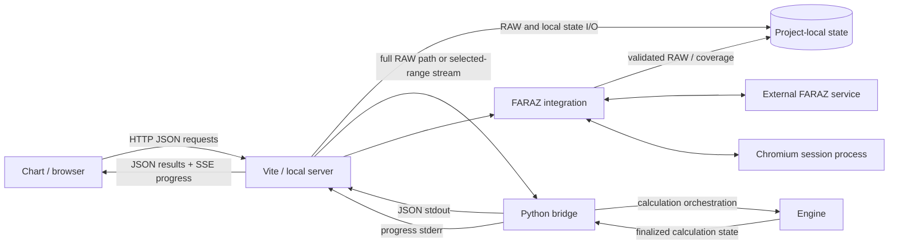

# TradingBot Technical Architecture

## 1. Purpose and boundary

This document is the maintained reference for the **Current TradingBot system architecture**. It describes subsystem ownership, runtime boundaries, data flow, state ownership, persistence/cache boundaries, process integration, and the public result path.

It is subordinate to the root [`AGENTS.md`](../../../AGENTS.md) and [Documentation Governance](../documentation-governance.md). It is not an Algorithm Reference, a UI/UX specification, a testing manual, a release guide, or a historical audit.

Detailed trading semantics belong to the current canonical trading-knowledge system and accepted Algorithm References. Detailed interaction and visual behavior belongs to the [UI/UX Reference](ui-ux-reference.md). Operational storage rules belong to [Local State](../operations/local-state.md).

## 2. Architectural authority and discovery

Architecture is reconstructed from the current live repository, with current Source/configuration defining executable behavior.

Use these durable discovery rules:

- discover production components from current runtime entry points, imports, configuration, and dependency closure;
- treat filenames named below as current examples and discovery anchors, not a permanent exhaustive inventory;
- do not define architecture by commit identity, hashes, mutable versions, module counts, route counts, test counts, or benchmark snapshots;
- use historical/generated material only as supporting evidence;
- if intended architecture and Current Source conflict, report the mismatch rather than rewriting Source or documentation to hide it.

The major architectural domains are **Chart**, **Vite/local server**, **FARAZ**, and **Engine**.

## 3. Architecture principles

1. **Engine owns trading truth.** Trading calculation, trading state, stage execution, lifecycle/reconciliation, and finalized semantic results belong to Engine.
2. **Chart owns presentation and interaction.** The browser may request, render, review, filter, and persist presentation/workspace state, but it must not independently recreate trading truth.
3. **Vite/local server owns orchestration and transport.** It validates local API requests, coordinates files/services/processes, selects the Engine input transport, persists transport/cache artifacts, and returns finalized results.
4. **FARAZ owns acquisition, not semantics.** FARAZ integration authenticates, retrieves, validates, and persists market data; it does not define TradingBot trading rules.
5. **Serialization is a projection boundary.** Serialization exposes finalized Engine state; it must not repair or redefine the calculation.
6. **Cache is subordinate.** Cached results and inventories are performance/persistence support, never semantic authority.
7. **State follows its owner.** Browser/workspace state, server orchestration state, acquisition/session state, and Engine calculation state are separate domains.
8. **Calculation scope and presentation scope are distinct.** The Engine calculates the complete input stream it actually receives; public range filtering is applied inside that supplied-input context.

## 4. System context

TradingBot is a workstation-style application with a browser UI, an in-process Vite/local HTTP server, a Python calculation subprocess, project-local persisted state, and an external FARAZ integration.



The diagram is conceptual. Internal files may be reorganized without changing this architecture if ownership and contracts remain the same.

## 5. End-to-end runtime flows

### 5.1 Chart loading

1. Chart requests the current RAW inventory from the local server.
2. The server resolves project-local RAW resources through the RAW store.
3. Chart requests the selected candle resource.
4. The server streams the RAW JSON and supports normal HTTP cache revalidation.
5. Chart normalizes the rows for visualization and owns the resulting presentation/workspace state.

This path does not perform trading calculation.

The workstation exposes direct `/chart`, `/faraz`, `/algorithm`, and `/alert` links. Chart links retain `chartId` and `tf` where applicable. Algorithm article links retain their section fragment, and a Manual Review link remains `/info/<id>`. The root URL and legacy algorithm fragments remain compatible. Workspace navigation, history and presentation stay in the browser. Vite matches the local API routes explicitly and returns a JSON 404 for unknown `/api` paths. `GET` and `PATCH /api/workspace-preferences` manage local preferences. The preferences store uses stable chart identity for per-chart settings and RAW bookmarks. The clock reads the selected broker-symbol profile and its verified holiday exceptions in the presentation layer.

### 5.2 Trading calculation

1. Chart builds a calculation request containing the selected chart identity, analysis/chart timeframes, inclusive user-selected range, direction, and request identity.
2. Vite validates resource identity, range boundaries, direction, and options.
3. Vite determines whether the requested range is the complete source or a selected subset.
4. Vite either supplies the original RAW path or prepares a selected in-memory row stream.
5. Vite launches the Python bridge as a child process with the current Engine component paths and calculation arguments.
6. The bridge loads the configured Engine components, reads the entire supplied input, normalizes chronology/candles, runs the required calculation/lifecycle pipeline, finalizes visibility/state, and serializes the requested direction output.
7. The standalone Python bridge writes progress to stderr and the final JSON result to stdout. A dedicated Live worker sends progress and the result as ordered messages on one stream. Vite forwards measured Engine and server stages through `/api/reactions/progress` using the calculation request identity. Chart records response parsing, object preparation and drawing time for the same request.
8. Vite returns the freshly serialized result to Chart and can retain a snapshot for Manual Review.
9. Chart renders the result and may open the Manual Review surface using the persisted calculation identity.

A manual Apply can start a dedicated Engine session scoped to its selected start, direction and analysis timeframe. The worker retains epoch-aligned RAW buckets, append lineage, and their market indexes. A verified append refreshes affected input buckets and index ranges, including the provisional tail. The trading stages recalculate at the requested horizon, including the last analysis candle. The bridge publishes the same indicator schema as the CLI.

The Engine publishes Basic, StopAll and directional primary T/F labels on final behavior rows. Each finalized directional primary resets the StopAll verdict history at its source candle. The shared response builder applies this stage for manual and live calculation. It computes the closed-candle horizon from the RAW duration supplied by Vite. Repeated StopAll rows carry both their evaluated verdict and the repetition flag. RAW repair lookup uses the reference direction, including after reversal. Chart renders those labels as presentation, and Manual Review continues to present finalized events. The Buy and Sell position stage consumes the finalized rows and closed analysis candles. It publishes stable position identities with entry, stop and visual target levels per regime. Chart owns generated position selection and presentation overrides. The [position algorithm reference](../../../engine/algorithms/TradingBot_Position_Algorithm_Reference.md) defines the shared Buy/Sell calculation.

The shared response builder publishes Foundation liquidity alongside positions. The Engine owns movement, repetition, collection, and line eligibility. Chart paints the published geometry and applies visibility preferences. The [position algorithm reference](../../../engine/algorithms/TradingBot_Position_Algorithm_Reference.md#foundation-liquidity) defines the liquidity contract.

During development, Vite polls the Chart sources, UI assets, Engine styles and the registered active Python files. Chart's indicator renderer can be replaced in memory while the chart instance and its state stay in place. Vite sends a status event for changes that require loading a new interface shell. Python source changes reuse the existing indicator calculation context for a new request that validates RAW and the active Source fingerprint. The recalculation refreshes the alert baseline. RAW, cache, tests, historical artifacts and server configuration remain outside this source watcher.

### 5.3 Market-data acquisition

1. Chart/FARAZ UI initiates an acquisition or update request through the local server.
2. FARAZ integration uses the current authenticated/session boundary to communicate with allowlisted FARAZ service hosts.
3. Received candle payloads are normalized and validated.
4. The RAW store persists valid project-local RAW data and associated metadata/coverage state.
5. The resulting RAW resource becomes available through the normal Chart inventory/load flow.

Acquisition creates or updates input data. It does not execute Engine trading semantics.

Real-time Chart polls the latest closed candles for one stable chart identity. The server derives the request from the resolved RAW tail and native timeframe. It rejects a stale source, serializes concurrent live requests for the same chart, and stages the validated RAW and sidecar before publishing the renamed pair. The browser receives the committed delta and updates its existing chart view.

Real-time verification independently reads closed native-timeframe OHLC from FARAZ. A second read confirms an ordered prefix of newly acquired rows before it is written to RAW. After the chart receives the committed append, it rechecks the preceding candle and up to 1,000 earlier stored candles for each appended candle. It combines overlapping windows within a batch and excludes the new tail from this historical pass. A source outage leaves the pending window eligible for retry. The polling interval is at least the RAW timeframe. While Real-time Chart is enabled, an independent ten-minute schedule runs Verify All across the entire closed RAW grid. Both checks use bounded native-timeframe packets, and Verify All also inserts missing candles supplied by FARAZ. The RAW sidecar records matched row ranges against the file digest. Corrections retain candle timestamps and are published with the corresponding RAW and metadata changes.

Each verification pass may have four packet reads in flight. The shared FARAZ request pacing still applies. The server consumes responses in native timestamp order. A failed packet ends the accepted prefix and cancels outstanding later reads. Latest acquisition finishes its first pass before requesting independent confirmation. Foreground gap verification merges disjoint checked ranges without rescanning the accumulated coverage for each packet. Its sidecar metadata comes from the same validated RAW bytes.

The browser checks the latest-candle response for recent verification support before requesting that phase. During a mixed-version workstation session, candle polling and Verify All remain available. The browser keeps the pending recent window until the server supports it or a full verification covers it.

A committed verification correction or restored gap requests a rebuild from the start of the applied range. Chart keeps the last successful result visible while the rebuild is pending or deferred. With automatic continuation enabled, the rebuild covers the current RAW tail at the chart timeframe. Otherwise it retains the applied end boundary. An accepted rebuild replaces the result and Live session and refreshes the alert baseline.

The continuation API binds the worker to the chart and the browser tab that applied or restored the calculation. Candle polling can continue while the indicator calculates. One continuation runs per tab, and newer candle batches request a catch-up to the latest committed RAW. The RAW store retains a bounded, in-memory chain of committed, byte-exact appends across file renames. Other tabs can replay an append using the prior file ID, last candle time and digest. This lets an inventory refresh apply only the committed candles and request a continuation immediately. When the chain reaches the worker's checkpoint, the server sends only the appended bytes. The worker verifies the complete new digest from its retained prefix hash, adds the new rows in order and calculates from the full session RAW. A newer append can supersede an in-flight snapshot without invalidating it. Apply can also publish a verified snapshot that the Engine has already consumed when its original file was renamed by a committed append. The append lineage must still reach the current RAW at publication. Historical corrections break the append chain and invalidate affected publications. Automatic indicator requests carry the digest of the RAW revision displayed in the requesting tab. A superseded revision prompts the tab to refresh the RAW and resume from its applied settings. Competing automatic candle checks and superseded calculation snapshots are reported as synchronization status. Interrupted Live HTTP requests or response bodies retry with the tab's last applied checkpoint and a fresh progress channel. If the short retries are exhausted, Live probes the local calculation API during the launcher's 75-second readiness window and resumes as soon as the service responds. The last valid result remains visible throughout the interruption. Background RAW inventory refreshes keep their last snapshot during the same startup window. A persistent connection failure is journaled once per interruption in each affected tab while later polls can still recover. Unexpected calculation and I/O failures enter the error journal. The continuation streams Engine progress and the chart reports completion once the accepted result is applied.

Each Live update reruns the Engine on the session’s validated RAW history. A worker verifies the exact append prefix and keeps normalized RAW, immutable candle views, and range indexes for its own session. An append refreshes only the affected tail, including an unfinished analysis bucket, and reuses bounded strict-crossing evidence over settled rows. The worker checks trend boundaries against the current chronology. It reuses a closed regime's independently calculated output when the new boundary and display bounds match and the entire prefix precedes the earliest changed candle. Each independent regime queries bounded windows of the worker's range indexes in local coordinates. The bridge reapplies T/F verdicts at the current horizon. A failed replay rolls back staged RAW and Decimal normalization and discards the derived indexes and retained prefixes before retrying. When the append proof is unavailable, the worker verifies the full RAW snapshot. After a restart or a historical revision, the server recovers the tab’s applied range and verifies or rebuilds it against current RAW. Chart can load the latest finalized calculation for its chart identity and display timeframe before starting any new Engine work. The server keeps the original RAW provenance with the saved result and rebinds the recovery proof to the requesting tab. The next Live recovery validates the proof against the Engine and current RAW. See [Local state](../operations/local-state.md) for the storage and cleanup contract.

## 6. Chart architecture

### Responsibility

Chart is the browser-side workstation and presentation owner. It owns:

- chart rendering and visual overlays;
- workspace navigation and interaction;
- user selection of symbols, timeframes, directions, and visible/calculation ranges;
- drawing interaction and presentation;
- browser-side preferences and workspace/session presentation state;
- calculation request initiation;
- progress consumption;
- rendering of finalized Engine results;
- live alert rule matching and delivery using published Engine event times;
- Manual Review presentation.

Current composition is rooted in the chart application entry point and supporting `src/` feature, chart, drawing, UI, and review modules. These paths are discovery anchors, not an exhaustive future inventory.

Chart startup defers the Algorithm workspace markup, content, and styles until that workspace is requested by navigation or a deep link. The workspace mounts the requested article and maintains its full navigation search independently of the mounted article. Route scroll and disclosure state survive article switches. Full-reference export generates every article on demand.

### Inputs and outputs

Chart consumes:

- RAW inventory/candle responses from the local server;
- persisted drawings/templates where exposed by the server;
- calculation progress events;
- finalized serialized calculation payloads;
- FARAZ acquisition/job status.

Chart produces:

- HTTP requests for data, state, acquisition, and calculation;
- user interaction and presentation-state changes;
- drawing persistence requests;
- browser-local preference state.

### Owned state

Chart owns ephemeral UI state and browser-local presentation preferences. Some durable presentation state, such as drawings and indicator templates/calculation artifacts, is persisted through the local server under project-local state ownership.

### Forbidden responsibility

Chart must not infer a different Reaction/A/S/E/Order/lifecycle result from candles or repair a serialized Engine result. The Manual Review implementation is explicitly presentation-only: behavior identity, prices, and Orders come from the bridge payload.

## 7. Vite / local-server architecture

The Vite configuration supplies the local backend boundary through server middleware and composes current service modules.

### Responsibility

The Vite/local-server layer owns:

- local HTTP/API routing and validation;
- browser/server mediation;
- RAW inventory and candle delivery;
- drawing/template and calculation-result persistence;
- calculation scheduling and Live session coordination;
- chart-transfer and RAW lifecycle orchestration;
- Engine child-process launch;
- full-source versus selected-range input preparation;
- SSE calculation-progress transport;
- response and error transport;
- integration of the FARAZ service module;
- serving the runtime review shell.

### Engine process boundary

Vite launches the Python bridge as a separate process. It provides Engine component locations and request arguments. The standalone bridge returns JSON on stdout and sends prefixed progress records on stderr. A dedicated Live worker sends framed progress and results on stdout, preserving each request's event order through the result message.

Apply, active Live replays, and Live recovery share one FIFO coordinator. It defaults to one active calculation and accepts a limit of 1 through 8 through `TRADINGBOT_MAX_ENGINE_CONCURRENCY`. The server reads and verifies the selected RAW at admission and verifies RAW and the active calculation Source before publishing.

A disconnect releases the client's progress stream and its interest in the calculation. Identical in-flight requests retain their remaining subscribers. The coordinator removes abandoned queued work before admission. Active cancellation interrupts the owned read, range transport, or worker operation and keeps the slot until that operation exits. A queued Live cancellation leaves the existing checkpoint available for a future request. A failed Windows range pipe also drains its consumer before the slot can be used again.

Progress history retains at most 120 events per request. A finished channel is released after its last observer disconnects. A late SSE connection can receive a buffered cancellation event followed by EOF. Reconnection can stop with HTTP 204 while the cancellation marker remains in the bounded history. Shutdown aborts owned calculations and closes progress channels.

Manual Review opens the report identity of an individual calculation. The server keeps a bounded registry of recent Live results and can save an individual report when Manual Review opens it. [Local State](../operations/local-state.md)

Vite does not reproduce Engine trading stages. Its calculation responsibility ends at validation, input preparation, process orchestration, transport, and persistence of already-serialized reports.

### Local file boundary

The server accesses project-local state through the shared local-state resolver. Direct Vite static access to state, test, archive, and verification areas is denied; supported application access occurs through explicit API/service paths.

## 8. FARAZ architecture

FARAZ is an external market-data integration owned by the local server domain.

### Verified responsibilities

FARAZ integration owns:

- user-driven browser/session establishment;
- local session-state handling;
- bounded external history requests;
- host validation for FARAZ service calls;
- candle-response normalization and validation;
- acquisition job status/cancellation;
- coverage/recovery coordination;
- persistence of acquired/updated RAW resources through the RAW store.

The current implementation can coordinate a Chromium-based browser process for session capture and reuse. Session material remains in the project-local secret boundary and must never be exposed in architecture documentation or logs.

Passive status requests share one in-flight upstream check for the current local session file. The server can reuse its status for up to 30 seconds while the file identity is unchanged. File replacement, deletion, logout, and shutdown invalidate or cancel the passive work. Explicit status checks invalidate the passive result and verify upstream using the selected symbol. Export startup also verifies upstream.

FARAZ history requests use bare minute counts for minute and hour timeframes, including `15` for `15M` and `240` for `4H`. Second and daily requests retain their suffixes. RAW names and metadata use the workstation timeframe. Historical export packets use an exclusive source end with an inclusive user-selected range bounded by the last closed candle. Session-aligned intraday exports keep source timestamps through changes in the market session, including daylight-saving transitions. Live append and verification currently require a fixed native timeframe grid.

Export cancellation closes active history requests and releases unpublished candles while a coverage decision is pending. Finished jobs keep their public status and discard the internal packet plan. Downloads stream the saved RAW file with backpressure and close the read stream on client disconnect.

### Boundary invariant

FARAZ data can become Engine input only after it is persisted/validated through the local data boundary. FARAZ does not own Reaction, Blue, A, S, E, Order, OrderAudit, StopAll, lifecycle, or any other trading semantic.

## 9. Engine architecture

Engine is the authoritative calculation subsystem under `engine/`. Its production closure must be discovered recursively from the current bridge/runtime loading and imports.

### System responsibility

Engine owns:

- authoritative trading calculations;
- normalized market chronology used by calculations;
- directional calculation state;
- stage-specific state and accepted objects;
- physical Order/OrderAudit calculation ownership;
- cross-stage lifecycle, visibility, priority, and StopAll reconciliation;
- finalized semantic results before transport/presentation.

### Current stage ownership model

Current Source contains separate owners for concepts such as Reaction/Reset, Blue, A, S, E, Order/OrderAudit, and lifecycle/StopAll. Shared helpers provide behavior-neutral Decimal, identity, direction, and chronology primitives where appropriate.

These names describe the current conceptual stage ownership. They are not a permanent exhaustive module list.

The bridge is the Engine integration/orchestration boundary. It loads the current calculation owners, prepares shared market context, coordinates the requested direction and required opposite-direction context, permits bounded lifecycle/order feedback where the current Engine requires it, finalizes public visibility, then serializes the result. Order_B feedback supplies the converged E and StopAll lifecycle to primary detection and visibility. Publication uses that same accepted state.

### Direction handling

Directional behavior is handled inside Engine using shared directional primitives and current stage owners. Direction is not implemented by browser presentation logic.

When finalized primary state ends a directional regime, the Engine bridge recalculates its independent historical prefix and starts the opposite regime from the complete boundary candle with fresh market, detector, lifecycle and Order state. Repeated transitions expose complete bounded directional segments; aggregate collections remain finalized output. The bridge owns input isolation and public index translation, while the primary stage owns the transition decision. Trading details belong to the accepted Algorithm References.

### Determinism and chronology

Engine assumes an ordered supplied market stream and uses normalized price/time structures appropriate to current Source. Price-sensitive semantic decisions remain Engine-owned. When lower-timeframe chronology is supplied, chronology-sensitive stage logic uses that Engine context rather than asking Chart to infer intrabar event order.

## 10. Input-scope contract

This boundary is critical.

### 10.1 Server scope decision

The browser supplies an inclusive user-selected range aligned to chart-candle boundaries.

The server classifies the request as one of:

- **complete source** — the requested chart range covers the available source;
- **selected range** — the requested chart range covers only part of the source.

For complete-source execution, the server gives the bridge the original RAW resource path.

For selected-range execution, the server reads the RAW resource, keeps only rows whose chart-timeframe buckets fall within the inclusive selected range, validates that the selected endpoints still exist, and supplies those selected rows to the bridge through the current in-memory range transport. In the current Windows-oriented implementation that transport is an ephemeral named pipe; it does not create another RAW data file.

### 10.2 Engine calculation scope

The bridge reads and calculates the **complete input stream supplied through its data input**.

Within that supplied stream, bridge `from/to` bounds identify the public/presentation window. The bridge does not truncate calculation state at the visible end before running the calculation; later rows in the supplied stream may therefore resolve state that began earlier in that same supplied stream.

Consequences:

- a full-source request has the complete original RAW resource available as Engine context;
- a selected-range request begins with only the selected rows supplied by the server;
- selected-range Engine state therefore begins at the first supplied selected row and cannot use hidden rows before that selection;
- presentation filtering is distinct from calculation over the supplied input;
- Engine calculation scope is bounded by the stream supplied to the bridge and is not implicitly expanded to hidden original-history rows.

### 10.3 Presentation scope

Chart controls what the user selects and displays. Engine/bridge controls calculation state over the input it receives and selects public rows for the requested output range. Presentation code must not retroactively change upstream calculation state.

## 11. Process and transport boundaries

| Boundary | Current contract |
| --- | --- |
| Browser ↔ local server | Local HTTP/JSON APIs; SSE is used for calculation progress |
| Local server ↔ Python bridge | Child process invocation with explicit arguments |
| Selected-range server ↔ bridge | Ephemeral in-memory named-pipe stream in the current Windows path |
| Full-source server ↔ bridge | Project-local RAW file path |
| Python bridge → local server | Final JSON on stdout |
| Python bridge → local server progress | Prefixed stderr events from the standalone bridge, or ordered stdout messages from the dedicated Live worker |
| Local server ↔ project state | Filesystem through project-local state owners |
| FARAZ integration ↔ external service | Network requests constrained by current FARAZ integration policy |
| FARAZ integration ↔ browser process | Chromium automation/session boundary where required for authentication |

Changing the transport mechanism does not necessarily change system architecture if ownership and observable contracts remain equivalent.

## 12. State ownership

| State class | Owner | Architectural rule |
| --- | --- | --- |
| Chart/workspace interaction state | Chart/browser | Presentation-only; not trading authority |
| Browser preference/session presentation state | Chart/browser storage/URL | May restore UI context; cannot restore authoritative Engine state |
| Drawings/templates | Chart semantics with server-backed local persistence | Presentation/user artifacts |
| RAW candles and sidecars | RAW store under chart/server data ownership | Validated Engine input material, not trading output |
| FARAZ authentication/session | FARAZ integration under secret state | Acquisition trust state; never trading semantics |
| Acquisition jobs/coverage | FARAZ/local server | External-data workflow state |
| Calculation progress channels | Vite/local server process | Transport/observability state only |
| Serialized calculation reports | Vite/local server local state | Snapshots for Manual Review |
| Trading calculation/lifecycle state | Engine | Authoritative for the current run |
| Historical/archive/verification evidence | Engineering governance owners | Evidence only; never runtime state |

Operational storage placement and migration rules are owned by [Local State](../operations/local-state.md), not duplicated here.

## 13. Cache and persistence boundaries

### Calculation freshness and reports

Apply executes the Engine even when the RAW and calculation settings match a previous request. Live updates replay validated RAW through the trading stages with detector state scoped to each calculation. The live worker retains input buckets, reusable market indexes, digest lineage, and the independently calculated prefixes of closed regimes. The current market sets the next trend boundaries and supplies the input for the active regime. A keep-alive request can maintain the session without publishing a calculation.

The server exposes a content fingerprint to validate the running Source. A calculation discards its result when the relevant Source or RAW changes during execution. Stored report payloads remain available by report ID for Manual Review.

### RAW inventory cache

The RAW store may cache validated inventory entries keyed by filesystem change evidence. When a RAW resource or sidecar changes, the store revalidates and refreshes its inventory representation. The store may repair current metadata sidecars as part of that ownership.

The initial scan validates RAW bytes and converts current coverage timestamps to runtime seconds once per sidecar. Chart retries a timed-out startup inventory request once. Later inventory refreshes reuse validated snapshots while the filesystem version matches.

### Browser caches and storage

Browser storage, Cache Storage, IndexedDB, and local preferences may contain presentation or request-related state. Clearing them cannot redefine Engine truth. Cache-clear workflows explicitly separate browser layers from server calculation/drawing/session layers.

## 14. Serialization and public-result boundary

The Python bridge owns conversion from finalized Engine-native calculation objects to the public JSON payload.

Architectural invariants:

- stage/lifecycle calculation occurs before public serialization;
- serialization does not apply a new trading rule;
- object identity, provenance, stable ordering, and null/absence meaning must not be silently changed at the transport boundary;
- additive presentation projections may describe finalized objects but cannot create new semantic objects;
- Vite persists/returns the bridge output rather than recalculating it;
- Chart and Manual Review consume the supplied result rather than deriving replacement trading decisions.

The complete public schema remains owned by current Source/contracts and accepted References; it is intentionally not copied into this architecture document.

## 15. Progress and error flow

Calculation progress follows this path:

`Engine/bridge phase → worker progress record → Vite progress channel → SSE → Chart progress UI`.

The final calculation follows:

`Engine/bridge finalized state → JSON stdout → Vite transport → Chart or Manual Review`.

Errors can originate at browser request validation, server validation/file I/O, child-process execution, Engine calculation, FARAZ acquisition, or external service boundaries. Each layer reports failure through its transport contract. Presentation may explain an error but must not substitute fabricated successful state.

## 16. Security and trust boundaries

Architecture-relevant trust boundaries are:

- browser content ↔ local HTTP service;
- local HTTP service ↔ project-local filesystem state;
- Node/Vite process ↔ Python Engine process;
- selected-range stream/file input ↔ Engine parser;
- local FARAZ integration ↔ external FARAZ network service;
- local FARAZ integration ↔ browser/session process;
- repository Source ↔ mutable runtime state;
- secret/session state ↔ non-secret application data.

The local server is a real service boundary even when used on one workstation. Runtime binding and firewall exposure are deployment/security concerns and must be reviewed from current startup configuration.

Secrets, cookies, tokens, private keys, and session contents must not enter maintained architecture documentation.

## 17. Dependency direction

The intended subsystem direction is:

```text
External FARAZ service
        ↕
FARAZ acquisition integration
        ↓
Validated project-local RAW/state
        ↓
Vite/local server orchestration
        ↓
Python bridge / Engine calculation
        ↓
Finalized serialized result
        ↓
Vite transport and report storage
        ↓
Chart / Manual Review presentation
```

Chart can initiate requests upstream, but semantic dependency runs from finalized Engine state toward presentation. Neither Chart nor transport layers may become an alternative source of trading truth.

Generated dependency graphs can support investigation but do not own this architecture.

## 18. Runtime, startup, and release boundaries

Startup tooling discovers the repository root, validates the required runtime/tooling environment, resolves the same project-local state policy used by the application, prepares required state directories, sets runtime environment needed by the local server/Engine integration, and starts the chart service.

Specific runtime/package versions belong to current manifests/startup compatibility checks rather than this conceptual architecture unless a version itself becomes an architectural protocol requirement.

Release publication is outside the live calculation architecture. Release mechanics are owned by [TradingBot release operations](../../../scripts/git/README.md). Release tooling may package/verify runtime closure but must not redefine subsystem ownership or trading semantics.

## 19. Architectural invariants and forbidden crossings

The following boundaries are durable:

- **Chart must not implement independent trading truth.**
- **Vite/local server must not become a second trading engine.**
- **FARAZ must not define trading semantics.**
- **Engine must not depend on browser presentation behavior.**
- **Serialization must not silently alter finalized Engine semantics.**
- **Transport must not reinterpret algorithm results.**
- **Caches must not become semantic authority.**
- **Historical/generated documentation must not define Current runtime architecture.**
- **Acquisition/session state must not become calculation state.**
- **Presentation-range clipping must not be confused with the supplied-input calculation scope.**

If current Source violates one of these boundaries, record the exact implementation path and the owning contract. A structural documentation check alone cannot establish that every runtime path preserves these boundaries.

## 20. Change and review triggers

Review this document when any of these change materially:

- subsystem ownership;
- browser/server/Engine/FARAZ process boundaries;
- Engine invocation or public result boundary;
- full-source versus selected-range input contract;
- persistence/cache ownership;
- state ownership;
- acquisition-to-RAW boundary;
- major transport direction;
- runtime/startup architecture;
- architecture-significant trust boundaries.

Do **not** rewrite it merely because:

- an Engine module is added or renamed inside the same ownership boundary;
- tests increase;
- package/runtime versions change without an architecture change;
- hashes or repository revisions change;
- route/file counts change;
- a UI component is added without a new architectural boundary;
- cache implementation changes while its ownership/contract stays the same.

## 21. Future-proof acceptance

This architecture remains valid under ordinary internal evolution:

- **New Engine module:** dynamically discovered through current runtime/import closure; document changes only if it creates a new architectural owner/boundary.
- **Internal package reorganization:** no architecture change when responsibilities and contracts are preserved.
- **Version changes:** no architecture change unless compatibility or process boundaries change.
- **New UI component:** usually a UI/UX concern unless it creates a new subsystem boundary.
- **Selected range:** remains governed by the supplied-input contract in Section 10.
- **Historical report:** cannot override this maintained Current reference.
- **Serialization defect:** investigate bridge/transport ownership; do not repair the truth in Chart.
- **FARAZ implementation change:** architecture remains stable while acquisition ownership and contracts remain stable.
- **Cache implementation change:** architecture remains stable while cache ownership/semantic subordination remain unchanged.

## 22. Current Project Path Roadmap

This roadmap is a Current navigation map of major project ownership boundaries. It is not an immutable file inventory: internal files may evolve while the durable subsystem responsibilities remain unchanged. Re-discover the live tree for every substantial task, and review this roadmap when a major domain moves, is renamed, is added or removed, or changes ownership.

| Current path | Owner / subsystem | Purpose and authority role | Important relationships / safety |
| --- | --- | --- | --- |
| [`AGENTS.md`](../../../AGENTS.md) | Root operating contract | Project authority, discovery, safety, engineering workflow, verification and publication boundaries | Read first for substantial work; it is not an Algorithm Reference. |
| [`README.md`](../../../README.md) | Project navigation | Human-facing project entry point and startup/navigation summary | Links to maintained owners; mutable implementation detail is discovered live. |
| [`.gitignore`](../../../.gitignore) and [`.gitattributes`](../../../.gitattributes) | Repository configuration | Ignore/tracking intent and byte/line-ending policy | Interpret with Repository Integrity and live Git state; ignored does not mean disposable. |
| [`.editorconfig`](../../../.editorconfig) | Editor configuration | Cross-editor formatting defaults | Tooling policy only; not semantic authority. |
| [`.github/workflows/`](../../../.github/workflows/) | CI | Current GitHub Actions workflows, including repository/documentation verification | CI proves only the checks it actually runs. |
| [`apps/chart/`](../../../apps/chart/) | Chart workstation | Browser application plus its local Node/Vite service boundary | Presentation and orchestration domain; must not become a second trading algorithm. |
| [`apps/chart/src/`](../../../apps/chart/src/) | Chart frontend | UI, chart/drawing features, workspace state, review and presentation logic | Consumes finalized Engine results; presentation cannot redefine trading truth. |
| [`apps/chart/server/`](../../../apps/chart/server/) | Vite/local-server services | Local API/service modules, RAW/state services, FARAZ integration and server-side helpers | Composed by Vite; owns transport/persistence orchestration, not trading semantics. |
| [`apps/chart/vite.config.js`](../../../apps/chart/vite.config.js) | Vite/local-server boundary | Main local backend composition, HTTP/SSE routes, Engine child-process orchestration and calculation scheduling | Launches the Engine bridge and composes current server modules. |
| [`apps/chart/server/faraz-candle-api.js`](../../../apps/chart/server/faraz-candle-api.js) | FARAZ integration | External market-data acquisition, session/auth integration, validation and RAW publication | FARAZ supplies validated market data and never owns trading semantics. |
| [`apps/chart/scripts/`](../../../apps/chart/scripts/) | Chart development startup | Chart-owned development-server entry/support tooling | Invoked by package/startup tooling; not a production trading owner. |
| [`apps/chart/package.json`](../../../apps/chart/package.json) and [`package-lock.json`](../../../apps/chart/package-lock.json) | Chart manifests | Current Node scripts and dependency contract | Discover current versions/scripts here instead of freezing them in conceptual docs. |
| [`apps/chart/tests/`](../../../apps/chart/tests/) | Chart tests | Current Chart/server/unit/contract verification | Test evidence verifies behavior; it is not trading-semantic authority. |
| `apps/chart/state/` ([Local State](../operations/local-state.md)) | Project-local runtime state | Dedicated machine-local state root for RAW, cache, secret and temporary state | Created by startup; a clean Git checkout may omit this directory. Current contents are not production Source. |
| `apps/chart/state/data/raw/` ([Local State](../operations/local-state.md)) | RAW evidence/data | Canonical runtime location for authoritative market-data resources and sidecars used as calculation input | Created by startup; RAW remains immutable evidence and must never be modified to make a test pass. |
| [`engine/`](../../../engine/) | Engine | Authoritative trading calculation domain | Discover production closure recursively from current runtime/import evidence. |
| [`engine/bridge/`](../../../engine/bridge/) | Engine bridge | Input normalization, calculation orchestration, progress and public serialization boundary | Serialization projects finalized state; it must not become a second algorithm. |
| [`engine/pipeline/`](../../../engine/pipeline/) | Engine production pipeline | Current stage owners and shared behavior-neutral calculation primitives | Internal module inventory is mutable; ownership and dependency closure must be discovered live. |
| [`engine/algorithms/`](../../../engine/algorithms/) | Accepted Algorithm References | First-class Bullish/Bearish synchronized algorithm specifications | Formal algorithm/reference authority according to root AGENTS; not generic engineering prose. |
| [`engine/tests/`](../../../engine/tests/) | Engine verification | Unit, regression, benchmark and verification tooling/evidence | Discover applicable runners dynamically; historical PASS is never a Current PASS. |
| [`engineering/docs/`](../) | Maintained engineering documentation | Current maintained normative/reference/procedure owners | Documentation Governance controls lifecycle/ownership; general docs do not override algorithm authority. |
| [`engineering/verification/`](../../verification/) | Verification evidence | Audits, migration/regression and final verification evidence | Evidence records observed state; it does not become Current authority merely by being newer. |
| [`engineering/archive/`](../../archive/) | Historical/archive evidence | Superseded, historical and forensic engineering material | Preserve provenance; Historical material must not be promoted to Current guidance. |
| [`scripts/`](../../../scripts/) | Project tooling/startup | Public startup entry points plus maintained tooling families | Inspect the owning subdirectory/tool before use. |
| [`scripts/launch.bat`](../../../scripts/launch.bat) and [`scripts/start.ps1`](../../../scripts/start.ps1) | Workstation startup | Check prerequisites and project-local state, start and supervise the Chart service, and display terminal status | The launcher delegates trading behavior to the existing runtime owners. |
| [`scripts/git/`](../../../scripts/git/) | Git/release subsystem | Main/production classification, validation, publication and recovery mechanics | Release operations own publication; do not invent a parallel release flow. |
| [`scripts/verification/`](../../../scripts/verification/) | Structural verification | Anti-Drift verifier and deterministic tests | Implements selected objective governance checks; manual semantic review still has separate ownership. |

The roadmap deliberately separates production Source from tests, maintained guidance from Historical evidence, runtime state from tracked Source, RAW from cache, engineering `main` from dependency-derived release `production`, Algorithm References from generic documentation, and verification evidence from semantic authority.

Runtime-created paths are logical storage locations linked to their Local State owner. They remain part of the roadmap even when absent from a clean checkout; the supported startup creates them. Source and maintained-document paths must exist in the checkout and retain exact repository casing.

## 23. Related maintained documents

- Root operating contract: [`AGENTS.md`](../../../AGENTS.md)
- Documentation lifecycle/ownership: [Documentation Governance](../documentation-governance.md)
- Maintained documentation navigation: [Engineering Documentation](../README.md)
- AI execution workflow: [AI Engineering Workflow](../ai/engineering-workflow.md)
- Detailed UI/UX owner: [UI/UX Reference](ui-ux-reference.md)
- Refactor/equivalence methodology: [Zero-Difference Refactor](../development/zero-difference-refactor.md)
- Local persistence/storage operations: [Local State](../operations/local-state.md)
- Repository structural verification: [Repository Integrity](../verification/repository-integrity.md)
- Release mechanics: [TradingBot release operations](../../../scripts/git/README.md)

For detailed trading semantics, retrieve the current canonical trading knowledge and current accepted Algorithm References according to root AGENTS rather than copying their mutable filenames or versions here.

## 24. Historical provenance

The previous maintained file was primarily a dated architecture/audit snapshot containing mutable paths, counts, versions, hashes, security findings, test results, and one-time audit conclusions. Its unique historical body is preserved byte-for-byte at [the archived architecture audit](../../archive/documentation/technical-architecture-audit-2026-09-22.md).

That historical evidence may explain past observations. It is not Current architecture authority.
