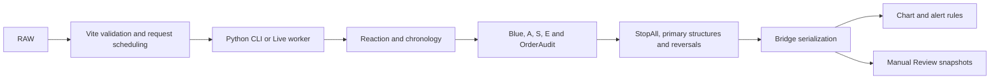

# گزارش مهاجرت و راستی‌آزمایی Engine

## A. نتیجهٔ اجرایی

Engine نسخهٔ `2.8.1` به پروژهٔ اصلی منتقل شد. Apply و هر درخواست محاسباتی Live، محاسبهٔ تازه اجرا می‌کنند. بهبود زمان و RAM در بعضی بارهای واقعی اندازه‌گیری شد و در بعضی بارها زمان افزایش یافت. نتیجهٔ کلی به پوشش آزمون‌های زیر محدود است.

## B. انتقال و سازگاری

- `A` از Working Tree پروژهٔ اصلی، همراه با تغییرات محلی زمان شروع، ثبت شد. `B` از منبع `TradingBot-2.8.1/engine` ثبت شد. `M` نسخهٔ بلافاصله بعد از انتقال و `Final` فایل‌های اجرایی نهایی در پروژهٔ اصلی هستند.
- از ۱۷ فایل مشترک اجرایی یا وابسته به اجرا، ۷ فایل از ابتدا یکسان بودند. ۷ فایل متفاوت با هش یکسان منتقل شدند. در سه فایل `live_pipeline.py`، `trading_pipeline.py` و `e_zone_detector.py`، تغییرات محلی پیشرفت Live و وضعیت عبور Order حفظ و با Source جدید ادغام شدند.
- مقایسهٔ مستقیم `B ↔ M` در ۶ سناریوی Historical، با سه جهت و تایم‌فریم‌های ۳۰ و ۱۸۰۰ ثانیه، برابری بایتی خروجی پایدار داشت. هش هر ۱۷ فایل در منبع 2.8.1 دوباره کنترل شد.
- هر ۱۶ فایل Python اجرایی یا package marker کامپایل شدند. هر ۱۳ ماژول اجرایی از مسیر واقعی پروژه import شدند. نسخهٔ API عمومی Engine ثابت ماند. نسخه‌های پیاده‌سازی فایل‌های تغییرکرده در جدول آمده‌اند.

## C. معماری و مالکیت

Vite اعتبار RAW، اجرای Worker و انتقال خروجی را مدیریت می‌کند. Engine کل محاسبه را انجام می‌دهد و Chart خروجی را نمایش می‌دهد. نتیجهٔ ذخیره‌شده فقط از مسیر مشاهدهٔ گزارش خوانده می‌شود. دو مرجع جاری Bullish و Bearish از نظر کد ضمیمه، هش و نمایهٔ نمادها با Source نهایی همگام شدند. متن قواعد معاملاتی و مراجع تاریخی حفظ شدند. افزونهٔ Intelligence پاسخ داد و بررسی یکپارچگی Vault در حالت `knowledge` موفق بود. پین‌های Vault به Snapshot قبلی تعلق دارند.

## D. تغییرات Source

| فایل | نسخهٔ A ← B ← Final | تغییر و اثر |
| --- | --- | --- |
| `bridge/live_pipeline.py` | `1.0.3 → 1.1.0 → 1.1.1` | Full Replay مستقل، حفظ پیشرفت Worker، ثبت دستهٔ RAW با بازگشت در خطا. کپی کامل فهرست تاریخچه در هر Append حذف شد. |
| `bridge/trading_pipeline.py` | impl `1.19.0 → 1.20.0 → 1.20.1` | مسیر مشترک ساخت بازار از RAW، آزادسازی نمایه‌های رژیم پس از مصرف و حذف مجموعهٔ تکراری bucket در ۱ ثانیه. زمان ساخت آرایهٔ تکراری و حافظهٔ آن متناسب با تعداد کندل‌ها بود. |
| `pipeline/core_utils.py` | `1.0.0` | نمایهٔ بازه‌های زمانی برای جست‌وجوی Reactionهای دربرگیرنده با حفظ ترتیب اولیه و حدود زمانی. |
| `pipeline/reaction_engine.py` | impl `9.13.0 → 9.13.2 → 9.13.3` | جست‌وجوی دربرگیری با نمایهٔ زمانی، حذف شاخهٔ بی‌اثر انتخاب کندل تأیید و آزادسازی نمایه‌های دارای ارجاع به رژیم‌های پایان‌یافته. |
| `pipeline/blue_line_detector.py` | `2.4.1` | استفاده از نمایهٔ دربرگیری در تشخیص Blue داخلی. مسیر سازگار برای ورودی‌های غیرمعمول حفظ شد. |
| `pipeline/s_zone_detector.py` | impl `4.22.0 → 4.22.1` | آغازدهی نمایهٔ Order مربوط به A متوقف‌شده به لایهٔ OrderAudit واگذار شد. |
| `pipeline/order_audit_engine.py` | impl `1.9.1 → 1.9.2 → 1.9.3` | جست‌وجو با اولین Order واجد شرایط خاتمه می‌یابد. نمایهٔ هندسهٔ اولیه یک‌بار در عمر Detector ساخته می‌شود. ساخت آن برای هر تغییر دفتر Order تکرار نمی‌شود. |
| `pipeline/e_zone_detector.py` | impl `6.20.0 → 6.20.1 → 6.20.2` | آغازدهی دفتر به OrderAudit واگذار شد. کپی فهرست نامزدها تا اولین تولید ادامهٔ تازه به تعویق افتاد. کمینهٔ عبورهای موروثی بدون فهرست موقت محاسبه می‌شود. |
| `pipeline/lifecycle_engine.py` | impl `1.22.0 → 1.22.1` | نمایهٔ اولین رویداد و آخرین توقف برای هویت‌های تکراری. جست‌وجوی مجدد اولین رویداد به lookup مستقیم تبدیل شد. |
| `pipeline/PL_PH_detector.py` | `1.4.0` | انعکاس Candle برای مسیر آینه‌ای هنگام دسترسی. ساخت اولیهٔ شیء انعکاسی برای هر ردیف حذف شد. |

تغییرات مصرف‌کننده محدود به مسیر Apply، نشست Live، حذف امکان reuse در مرورگر و آزمون‌های مربوط به آن است. A، True/False، تنظیمات اجرایی و داده‌های RAW در این مهاجرت جایگزین نشدند.

## E. عملکرد Historical

<!-- HISTORICAL_BENCHMARKS_BEGIN -->
| RAW / تایم‌فریم / جهت | Wall زمان A / B / Final | CPU زمان A / B / Final | اوج RAM A / B / Final | تغییر Final نسبت به A |
| --- | --- | --- | --- | --- |
| ۱۵٬۰۶۱ / ۱s / both | ۷٫۴۹۹ / ۵٫۰۷۴ / ۵٫۱۹۱ | ۷٫۰۹۴ / ۵٫۰۳۱ / ۵٫۰۷۸ | ۱۱۴٫۵۷۰ / ۹۱٫۱۷۲ / ۸۵٫۱۷۶ | Wall ۳۰٫۸٪ کاهش، CPU ۲۸٫۴٪ کاهش، RAM ۲۵٫۷٪ کاهش |
| ۶۰٬۳۲۷ / ۳۰s / bullish | ۳٫۳۷۱ / ۳٫۲۶۱ / ۴٫۸۱۸ | ۳٫۲۹۷ / ۳٫۲۰۳ / ۴٫۲۳۴ | ۱۲۳٫۳۴۴ / ۱۱۹٫۰۹۰ / ۱۱۸٫۹۵۳ | Wall ۴۲٫۹٪ افزایش، CPU ۲۸٫۴٪ افزایش، RAM ۳٫۶٪ کاهش |
| ۹۷٬۹۳۰ / ۱۸۰۰s / bearish | ۱٫۴۸۰ / ۱٫۵۰۶ / ۱٫۳۹۹ | ۱٫۴۳۸ / ۱٫۳۴۴ / ۱٫۳۴۴ | ۱۶۹٫۶۴۵ / ۱۶۹٫۳۰۱ / ۱۶۷٫۸۱۲ | Wall ۵٫۵٪ کاهش، CPU ۶٫۵٪ کاهش، RAM ۱٫۱٪ کاهش |
<!-- HISTORICAL_BENCHMARKS_END -->

هر سلول میانهٔ سه اجرای مستقل است. واحد زمان ثانیه و واحد اوج Working Set برابر MiB است. مرحله‌ها، CPU و RAM هر اجرا در `final-bench.jsonl` ثبت شده‌اند. پروفایل جداگانهٔ Candidate روی ۱۵٬۰۶۱ کندل در ۱ ثانیه و ۶۰٬۳۲۷ کندل در ۳۰ ثانیه نشان داد E حدود ۴٫۸ و ۱۰٫۴ ثانیه زمان تجمعی مصرف کرده است. بخش‌هایی از آن در کشف زنجیره‌ها و جست‌وجو و ثبت Order مصرف شد. زمان پروفایل در جدول بنچمارک وارد نشده است. داده‌های Wall و CPU به بار هم‌زمان محیط حساس‌اند.

## F. عملکرد و بازیابی Live

نشست Node پس از موفقیت Worker و پیش از انتشار، شناسهٔ RAW را برای اثبات تداوم نگه می‌دارد. Worker ورودی RAW را نگه می‌دارد و همهٔ مراحل را روی درخواست محاسباتی تازه اجرا می‌کند. پس از تغییر یا حذف بخشی از تاریخچه، مسیر بازیابی از RAW فعلی دوباره محاسبه می‌کند. اگر Seed همان درخواست کل بازهٔ جاری را پوشش دهد، پس از اعتبارسنجی مستقیم منتشر می‌شود. Seed تاریخی باید تا آخرین RAW پیش برود. تأیید Alive تنها نشست را فعال نگه می‌دارد. نتیجهٔ معامله از کش مرورگر، دیسک یا پاسخ تکمیل‌شدهٔ Worker به Apply یا ادامهٔ Live وارد نمی‌شود. دو درخواست هم‌زمان برای همان ورودی Live می‌توانند منتظر همان محاسبهٔ در حال اجرا بمانند.

<!-- LIVE_BENCHMARKS_BEGIN -->
| نسخه | Wall p۵۰ / p۹۵، ms | CPU p۵۰، ms | Working Set نهایی / اوج، MiB |
| --- | --- | --- | --- |
| A | ۴۸۸ / ۵۶۷ | ۴۳۸ | ۷۶٫۷ / ۸۰٫۸ |
| B | ۹۱۱ / ۱۱۰۹ | ۶۷۲ | ۵۹٫۳ / ۶۴٫۵ |
| final | ۹۳۴ / ۱۰۹۹ | ۶۰۹ | ۵۹٫۵ / ۶۴٫۵ |

این مقایسه روی RAW ثابت ۱۵٬۰۶۱ کندلی، تایم‌فریم ۳۰ ثانیه و جهت Both انجام شد. صدک ۹۵ با پنج نمونهٔ Append برابر بیشترین زمان نمونه است. Seed و درخواست‌های بدون تغییر در محاسبهٔ صدک‌ها وارد نشده‌اند. بازیابی و ارسال روی شبکه نیز در این دو صدک لحاظ نشده‌اند.
<!-- LIVE_BENCHMARKS_END -->

اجرای مستقیم Worker روی بزرگ‌ترین RAW در جهت Bullish و تایم‌فریم ۱ثانیه با مهلت پیش‌فرض ۳۰۰ثانیه‌ای سرور پایان نیافت. مدت ثبت‌شده ۳۰۰٫۶ ثانیه و اوج Working Set ۷۷۳٫۰ MiB بود. Stage A حدود ۵۳٫۱ ثانیه طول کشید. آخرین مرحلهٔ اعلام‌شده پیش از توقف، S بود.

در آزمون فشار محدود ۶۰ثانیه‌ای Bearish، ۵۰ Append و سپس ۵ محاسبهٔ تکراری انجام شد. Working Set بعد از GC از حدود ۵۱٫۵ به ۵۴٫۰ MiB رسید و اوج به ۵۶٫۹ MiB رسید. در این اندازهٔ ورودی، نتیجهٔ تکرارها یکسان بود. در آزمون تخصیص حافظهٔ ۱۸۰۰ثانیه‌ای روی همین ورودی، tracemalloc حدود ۸٫۱ MiB اوج تخصیص ثبت کرد. این دو مشاهده برای نشست‌های طولانی با RAW بزرگ کافی نیستند.

## G. آزمون‌ها

<!-- MATRIX_STATUS_BEGIN -->
ماتریس Historical از ۸ ورودی RAW یکتا، ۱۶ تایم‌فریم Chart و ۳ جهت تشکیل شد. زمان ثبت وضعیت `2026-11-19T00:47:28+03:30` بود. وضعیت مقایسهٔ نهایی A، B و Final از ۳۸۴ سناریو ۲۳۰ PASS، ۰ FAIL، ۴ INCOMPLETE و ۱۵۰ NOT RUN است. آزمون‌های ۴۸گانهٔ کوچک‌ترین RAW کامل شدند. مقایسهٔ نسخه‌های ثبت‌شدهٔ A و B در ۶۵ سناریو خروجی پایدار یکسان داشت.

اجرای مستقل Final روی ۵۰۴٬۷۱۱ کندل، تایم‌فریم ۱ ثانیه و هر دو جهت به سقف ۲۴۰ ثانیهٔ سناریو رسید. این اجرا خروجی قابل مقایسه ارائه نکرد.
<!-- MATRIX_STATUS_END -->

| بررسی | وضعیت | شواهد |
| --- | --- | --- |
| Engine واحد | `PASS` | ۵۲۱ آزمون |
| Chart واحد | `PASS` | ۳۶۵ آزمون |
| HTTP/Worker/SSE و بازیابی Live | `PASS` | دو آزمون با دادهٔ ساختگی و دو آزمون با ورودی واقعی. شامل Append، راه‌اندازی مجدد، بازبینی تاریخچه، بازیابی با یک اجرای معتبر و درخواست بدون تغییر. احراز هویت و دریافت از بازار زنده در این اجرا مستقل آزموده نشد. |
| Chrome از مسیر UI | `PASS` | دو Apply روی یک ورودی، دو فراخوانی Python و دو شناسهٔ گزارش. `X-QG-Cache: bypass` در هر دو. Viewport برابر ۱۴۴۰×۹۰۰ و بدون خطای JavaScript. یک پاسخ ۴۰۴ منبع در Console دیده شد. |
| Exact Source References | `PASS` | ۱۶ بلوک Source برای هر جهت با هش، تعداد بایت، تعداد LF و کامپایل تأیید شدند. |
| Order_B و MBL | `PASS` | در RAW نمونه، ۱۳ Order نزولی و ۶ Order صعودی با عبور دقیق تأیید شدند. کنترل MBL شکل‌گرفته در A، B و Final گذشت. |
| قواعد مخزن، Build و سیاست انتشار | `PASS` | Anti-drift، ۳۱ آزمون verifier، Build Vite، `RepositoryCoverage` و `ProductionClosure`. |
| Ruff | `INCOMPLETE` | بررسی نام‌های تعریف‌نشده پاس شد. گزارش سراسری ۶۷۷ مورد دارد. بیشتر آن‌ها استفاده از getattr ثابت‌اند. موارد مربوط به importهای سازگاری، خطاپذیری و کنترل جریان به‌طور کامل پاک‌سازی نشدند. |
| قرارداد خطای CLI | `PASS` | برای RAW خالی، JSON خراب و تایم‌فریم نامعتبر، کد خروج، پاسخ و پیام تشخیصی پایدار در سه نسخه برابر بود. |

## H. قرارداد Zero-Difference

خروجی Historical با مقایسهٔ مستقیم بایت‌های JSON، ترتیب کلیدها و آرایه‌ها و نوع و مقدار فیلدها سنجیده شد. تنها فیلد بیرونی `timings` حذف شد. Live در افق‌های Seed، Append یک‌تایی و دسته‌ای، و درخواست بدون تغییر با اجرای مستقل CLI مقایسه شد. آزمون‌های واحد پوشش جداگانه‌ای برای حدود مربوط به Decimal، Equality، Mirror و State دارند. در نمونهٔ ۳۰ثانیه‌ای، تغییر seed هش و محدودکردن بازهٔ نمایش در CLI هم برابری بایتی را حفظ کردند. بررسی برابری تمام وضعیت‌های داخلی روی هر هشت RAW و تمام تایم‌فریم‌ها تکمیل نشده است. RAWهای این مقایسه از داده‌های موجود ۵ثانیه‌ای‌اند. آزمون تایم‌فریم ۱ثانیه‌ای روی این ورودی‌ها، منشأ ۱ثانیه‌ای برای OHLC ایجاد نمی‌کند.

## I. موارد باز

- اجرای CLI با Blue، A و S غیرفعال و تنظیمات مشخص بارگذاری Primary، در A، B و Final با `KeyError('bullish')` شکست خورد. خطا در مرجع اولیه هم بازتولید شد و قرارداد رفتاری این حالت در این کار عوض نشد.

- بازپخش کامل Live روی تاریخچهٔ بزرگ هنوز هزینهٔ وابسته به حجم تاریخچه دارد. تغییر مسیر به محاسبهٔ افزایشی بدون اثبات برابری و با توجه به شرط محاسبهٔ تازه پذیرفته نشد.
- تحلیل Stageها نشان می‌دهد E و OrderAudit سهم عمده‌ای از CPU دارند. معماری چرخه و تکرار مرحله‌های E به چند محاسبهٔ مستقل وابسته است. حذف مرحله‌های دیگر بدون شواهد پوشش گسترده خطر تغییر Order و Lifecycle دارد.
- اعداد بنچمارک شامل بارهای اندازه‌گیری‌شده‌اند. افزایش سرعت برای تمام تنظیمات و برای Live تأیید نشد.
- یک RAW باز در پروژهٔ اصلی حین کار توسط فرایند موجود به‌صورت Append تغییر نام داد. تطابق بایتی پیشوند آن با ورودی ثبت‌شده تأیید شد. همهٔ اجرای مقایسه‌ای روی ورودی‌های ثابت انجام شد.

## J. وضعیت فایل‌ها و بازگشت

Source اجرایی در Working Tree شاخهٔ `main` قرار دارد. Snapshot پیش از انتقال، موجودی هش‌ها، تفاوت‌ها، خروجی‌های پایدار، گزارش‌های اجرا و شواهد Chrome در `apps/chart/state/tmp/engine-migration-20261118/` قرار دارند. تغییرات محلی پیش از شروع حفظ شدند. Git در زمان ثبت گزارش ۴۲ فایل تغییرکرده و ۳ مسیر Untracked نشان می‌دهد. این شمارش تغییرات محلی پیشین را هم شامل می‌شود. ZIP، Commit، Push، Tag یا Deploy انجام نشد.

## K. نتیجهٔ نهایی

- **Correctness** `ZERO-DIFFERENCE NOT VERIFIED`
- **Performance** `NOT VERIFIED` به‌عنوان نتیجهٔ سراسری. جدول‌ها بهبود و کندی بارهای اندازه‌گیری‌شده را نشان می‌دهند.
