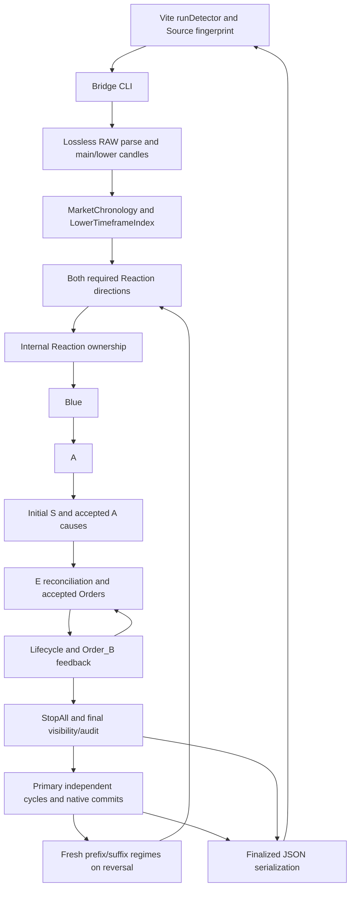

# Dependency and ownership

The discovered live production set is enumerated in `01_ENGINE_FILE_INVENTORY.csv`; the independently checked complete-read ranges and initial byte hashes are in `discovery/full-read-coverage.json`. Import statements extracted from all current production Python files are in `discovery/imports.json` and supplement, rather than replace, the team full-source reads. Package markers are included, and archive `engine/engine.zip` is not runtime authority.

## Owners and data lifetimes

| Current file | Owner and important consumers | State / lifetime / sensitive contract |
| --- | --- | --- |
| `engine/bridge/trading_pipeline.py` | Input/orchestration/projection; CLI spawned by Vite | Complete supplied history, both required directions, bounded E/Order_B feedback, final visibility, primary callbacks and independent regimes; serializers preserve native truth |
| `engine/pipeline/reaction_engine.py` | Reaction/Reset, Candle/chronology/lower indexes, geometric Order helpers | Exact Decimal, GREEN Doji, canonical First/Break, strict confirmations and lower event order; caches and Candidate mutations require lifetime review |
| `engine/pipeline/blue_line_detector.py` | Blue scale/Reset strikes and internal/public markings | Exact confirmation-inclusive lower prefix, directional extreme and original source; consumes Reaction context |
| `engine/pipeline/a_zone_detector.py` | Blue-pair A formation, continuation and source extrema | Lower interval endpoints and earliest equal physical source; downstream S consumes provisional A |
| `engine/pipeline/s_zone_detector.py` | S qualification/decisions, accepted A and initial Order audit | Candidate windows and strict races, last-equality exceptions, shared accepted Order stop reconciliation |
| `engine/pipeline/e_zone_detector.py` | E chains, source reconciliation and accepted native Order state | Parent-stop caches, invalidation, independent roots, accepted audit rebuilds and continuation; delegates physical Orders |
| `engine/pipeline/order_audit_engine.py` | Physical Orders, reset legs, accepted causes, native primary parent registration | Physical `(FirstIndex,BreakIndex)`, confirmation/source/stop identity, context-sensitive caches and mutation indexes |
| `engine/pipeline/lifecycle_engine.py` | Dominance, hard StopAll, visibility and accepted audit projection | Chronological state machine; preserves historical acceptance independently of current public visibility |
| `engine/pipeline/PL_PH_detector.py` | Primary cycles/MBL/final-number arbitration, native Order race, primary3 reversal | Frozen MBL, independent logical cycles, immediate native callbacks and prospective-decision invalidation; fresh regimes remain Bridge-owned |
| `engine/pipeline/core_utils.py` | Shared exact Decimal and physical identity primitives | No trading policy moved here |
| `engine/pipeline/direction_policy.py` | Shared directional price side/comparators | Geometry mirrors; time/identity/families remain invariant |
| `engine/__init__.py`, `engine/bridge/__init__.py`, `engine/pipeline/__init__.py` | Package/reconstruction bootstrap | Retained in exact Reference contract; flat sibling imports initialized by supported entry paths |

Detailed source/caller/test evidence: `reviews/bridge-review.md`, `reaction-review.md`, `zones-review.md`, `orders-primary-review.md`. Both current Reference reviews and the protocol review are separate under `reviews/`.

## External execution closure

`apps/chart/vite.config.js` anchors all current Engine module paths, includes production detector/helper/primary bytes in `calculationSources`, and spawns Python with `--engine/--blue-engine/--a-engine/--s-engine/--e-engine/--stopall-engine`. It passes current public timeframe, direction and range options plus `--bridge-output`; `PYTHONDONTWRITEBYTECODE=1` is set. Its full-file vs selected-stream transport is governed by `apps/chart/server/indicator-range-input.js`; selected buckets become the complete supplied input, distinct from an Engine presentation window. The browser and Manual Review consume the finalized payload. No planned implementation-only candidate justifies Chart/server edits or a second trading algorithm.

Current Python runtime imports use the standard library plus installed runtime dependencies declared by root README/startup (`orjson`, `tzdata`). Tests/regression/benchmarks/verification, archive ZIPs, CSS and bytecode are separately classified. Any newly discovered imported production file must be added to this run's closure rather than excluded by the current count.

## Contract exclusions and conflicts

Only top-level response `timings` is documented non-stable telemetry (`build_response_payload`, maintained zero-difference/testing procedure and current regression helper). stderr QG_PROGRESS durations are retained raw but do not define stable JSON. No version, identity, cause, price, key, public/internal flag or array is excluded. API version fields remain observable; an implementation-version convention cannot justify silently removing them from equality.

Recorded semantics ambiguities and stale evidence are in `00_AUTHORITY_AND_GIT_BASELINE.md`. They are not corrected by this audit. Full-read and byte synchronization prove scope understanding/integrity; runtime equivalence remains a separate gate.
